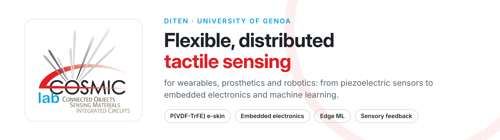
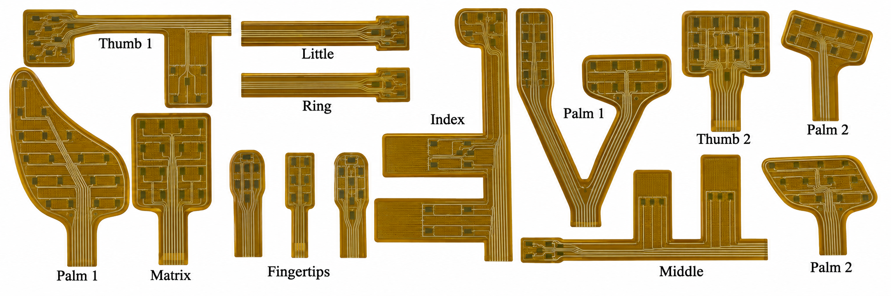
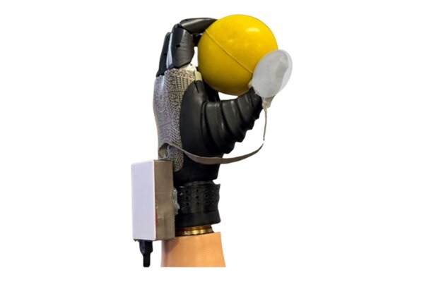
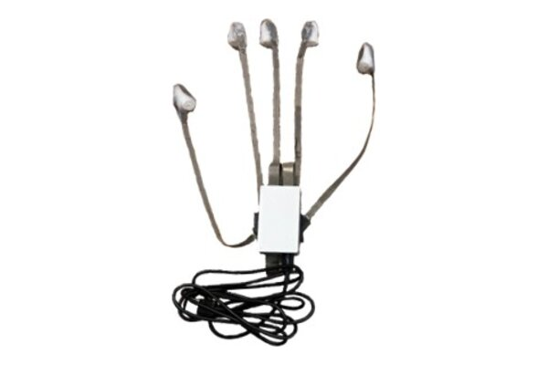
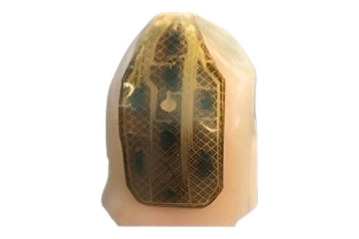

<picture>
  <source media="(prefers-color-scheme: dark)" srcset="img/banner-dark.png">
  
</picture>

**COSMIC Lab** (Connected Objects, Sensing Materials and Integrated Circuits) is a research group at DITEN, the Department of Electrical, Electronic, Telecommunication Engineering and Naval Architecture of the University of Genoa.

We build artificial tactile sensing systems: flexible piezoelectric skins, the electronics that read them, and the algorithms that turn their signals into touch, for prosthetic hands, robots and wearables.

  <a href="#research"><b>Research</b></a> ·
  <a href="#where-our-sensors-are-used"><b>Where our sensors are used</b></a> ·
  <a href="#datasets-and-papers"><b>Datasets and papers</b></a> ·
  <a href="#code"><b>Code</b></a> ·
  <a href="#collaborations"><b>Collaborations</b></a>

## Research

<table>
  <tr>
    <td colspan="2" width="100%" valign="top">
      
      <h3>Piezoelectric e-skin</h3>
      
Screen-printed P(VDF-TrFE) sensors on flexible substrates, shaped for fingertips, fingers and palm and embedded in soft silicone. They respond to time-varying contact forces from below 1 Hz to 1 kHz.

      
On the Hannes prosthetic hand, two sensorized finger caps enable real-time mechanical stress reconstruction and contact localization.

      
<a href="https://intelliman-project.eu/media/UNIGE-Demo.mp4"><b>Watch the Hannes demo</b></a> · <a href="https://intelliman-project.eu/demonstrator/#uc1-real">IntelliMan demonstrator</a>

    </td>
  </tr>
  <tr>
    <td width="50%" valign="top">
      
      <h3>Tactile perception and edge ML</h3>
      
Force reconstruction, texture and hardness recognition, object recognition and slip detection, with neural, spiking and neuromorphic models sized for microcontrollers and FPGAs.

       <a href="https://github.com/cosmiclab-unige/Force_recontruction_algorithm">Force reconstruction</a> · <a href="https://github.com/cosmiclab-unige/sie2024-FPGA-CRNN">FPGA CRNN</a> · <a href="https://github.com/cosmiclab-unige/hardware-aware-nas-imu">HW-aware NAS</a>
    </td>
    <td width="50%" valign="top">
      
      <h3>Embedded interface electronics</h3>
      
Compact boards that digitise the sensor charge and process it on an STM32 microcontroller: 64 channels at 2 kSa/s, 16 bit, streamed over USB-C.

       <a href="https://github.com/cosmiclab-unige/gamma-interface">gamma-interface</a>
    </td>
  </tr>
</table>

## Where our sensors are used

<table>
  <tr>
    <td width="33%" align="center"> <b>Hannes</b> prosthetic hand</td>
    <td width="33%" align="center"> <b>AR10</b> robotic hand</td>
    <td width="33%" align="center"> <b>Finger cap</b> for human users</td>
  </tr>
</table>

We have also fitted the sensors to the Michelangelo prosthetic hand, the TIAGo robot gripper and a Baxter gripper.

## Datasets and papers

Tactile signals and simulation data released with our papers, newest first. Each dataset link opens its Zenodo record, and each DOI opens the paper on the publisher's website.

| Dataset on Zenodo | What is inside | Paper | DOI |
|---|---|---|---|
| [Contact and slip detection](https://zenodo.org/records/23949914) | 8 P(VDF-TrFE) channels on a silicone fingertip, 2 kHz. 300 trials of contact onset, slip onset and release, plus 150 trials on three textures. | *Contact Events and Slip Onset Detection Based on a Piezoelectric Sensing System and Embedded Machine Learning* IEEE Sensors Letters, 2026 | [10.1109/LSENS.2026.3714000](https://doi.org/10.1109/LSENS.2026.3714000) |
| [Texture domain adaptation](https://zenodo.org/records/23951041) | 8 channels on a finger cap worn by 3 participants exploring 12 natural textures, 2 kHz. | *Linear Optimal Transport for Domain Adaptation in Neuromorphic Tactile Texture Classification* Lecture Notes in Electrical Engineering, 2026 | [10.1007/978-3-032-17174-0_37](https://doi.org/10.1007/978-3-032-17174-0_37) |
| [Object recognition on TIAGo](https://zenodo.org/records/18790001) | 32 channels on a TIAGo gripper, 500 Hz. 6 objects, 50 grasps each. | *Flexible Piezoelectric Tactile Sensing System for Intelligent Object Recognition* IEEE Sensors Journal, 2026 | [10.1109/JSEN.2026.3669666](https://doi.org/10.1109/JSEN.2026.3669666) |
| [Hardness and texture on Hannes](https://zenodo.org/records/23925114) | 8 PVDF channels in the thumb of the Hannes prosthetic hand. 200 grasps of four objects (press, hold, release). | *Hardness and Texture Recognition based on PVDF Sensors and Embedded Machine Learning: A case study on Hannes prosthetic hand* IEEE ISCAS, 2025 | [10.1109/ISCAS56072.2025.11043586](https://doi.org/10.1109/ISCAS56072.2025.11043586) |
| [Multisensory glove](https://zenodo.org/records/18783222) | The same glove dataset as *Multisensory Wearable Glove*, below, run on a GAP9 microcontroller. | *Real-Time Object Recognition Based on Parallel Ultra-Low-Power Microcontroller: A case study on Multisensory Glove* IEEE ISCAS, 2025 | [10.1109/ISCAS56072.2025.11044209](https://doi.org/10.1109/ISCAS56072.2025.11044209) |
| [Contact force estimation](https://zenodo.org/records/18782479) | 8 screen-printed channels, 2 kHz, with a load cell reference. Indentation by a Cartesian robot at 7 forces and 7 speeds. | *Machine Learning Based Contact Force Estimation Using a PVDF Tactile Sensing System* IEEE NEWCAS, 2025 | [10.1109/NewCAS64648.2025.11107072](https://doi.org/10.1109/NewCAS64648.2025.11107072) |
| [Contact and slippage on a finger cap](https://zenodo.org/records/18759556) | 8 PVDF channels in a soft finger cap, with force/torque ground truth. 2 subjects pressing, sliding and releasing on smooth and rough textures. | *Contact and Slippage Detection Algorithm using a Soft PVDF-based Sensing System* IEEE ICECS, 2025 | [10.1109/ICECS66544.2025.11270690](https://doi.org/10.1109/ICECS66544.2025.11270690) |
| [Sensor transfer function](https://zenodo.org/records/18783828) | Force-to-voltage transfer function of the tactile sensor, measured with a shaker from 1 Hz to 1 kHz. | *Interface Electronics for PVDF Based Tactile Sensor* IEEE BATS, 2025 | [10.1109/BATS67559.2025.11336158](https://doi.org/10.1109/BATS67559.2025.11336158) |
| [Soft fingertip slippage](https://zenodo.org/records/18788028) | Finite element results for a hemispherical Dragon Skin fingertip on a rigid surface. | *Understanding Slippage in Soft Fingertips Through Finite Elements Analysis* ASME IDETC-CIE, 2025 | [10.1115/DETC2025-168595](https://doi.org/10.1115/DETC2025-168595) |
| [Force myography gestures](https://zenodo.org/records/18760304) | 24 channels on a forearm armband. 5 participants performing 11 hand and wrist gestures. | *A Case Study: FMG-based Gesture Recognition using High-Density Piezoelectric Electronic Skin and Machine Learning* IEEE Sensors Letters, 2025 | [10.1109/LSENS.2025.3624027](https://doi.org/10.1109/LSENS.2025.3624027) |
| [Shape, size and stiffness glove (D_Objects)](https://zenodo.org/records/20843033) | 5 force sensors and 5 IMUs on a glove. 5 participants grasping 16 3D-printed objects. | *Wearable Multisensory Glove for Shape, Size, and Stiffness Recognition Based on Off-the-Shelf Components* IEEE Sensors Letters, 2025 | [10.1109/LSENS.2025.3548264](https://doi.org/10.1109/LSENS.2025.3548264) |
| [Viscoelastic e-skin simulation](https://zenodo.org/records/18789463) | Finite element data on transmitted stress, strain and contact forces, simulated in Ansys. | *Stress Transmission in a Soft Electronic Skin with Viscoelastic Properties* Lecture Notes in Electrical Engineering, 2025 | [10.1007/978-3-031-71518-1_29](https://doi.org/10.1007/978-3-031-71518-1_29) |
| [Neuromorphic texture classification](https://zenodo.org/records/23923511) | 8 channels on a biomimetic fingertip, 2 kHz. 8 gratings × 6 sliding conditions × 100 trials. | *Neuromorphic Tactile Sensing System for Textural Features Classification* IEEE Sensors Journal, 2024 | [10.1109/JSEN.2024.3382369](https://doi.org/10.1109/JSEN.2024.3382369) |
| [Multisensory glove](https://zenodo.org/records/18783222) | 5 force sensors and 5 IMUs (35 channels) on a glove, 200 Hz. 5 participants grasping 28 everyday objects. | *Multisensory Wearable Glove for Object Recognition Based Embedded Machine Learning* IEEE ICECS, 2024 | [10.1109/ICECS61496.2024.10848876](https://doi.org/10.1109/ICECS61496.2024.10848876) |
| [Hannes grasps](https://zenodo.org/records/18787630) | 8 sensors on the Hannes prosthetic hand. 3 grasp types at 3 speeds, 5 repetitions each. | *Biomimetic Tactile Sensing for Hannes Anthropomorphic Prosthetic Hand* IEEE ICECS, 2024 | [10.1109/ICECS61496.2024.10848734](https://doi.org/10.1109/ICECS61496.2024.10848734) |
| [Hardness discrimination](https://zenodo.org/records/18784021) | 8 channels in a finger-shaped silicone cap, 2 kHz. Indentation of cubes at different hardness levels. | *Hardness Discrimination Using Piezoelectric-Based Biomimetic Tactile Sensor and Machine Learning* IEEE Sensors Letters, 2024 | [10.1109/LSENS.2024.3431430](https://doi.org/10.1109/LSENS.2024.3431430) |
| [Texture glove (D_T1000)](https://zenodo.org/records/20835836) | 8 PVDF channels on the index finger of a glove, 2 kHz. 7 participants exploring 6 textures. | *Texture Perception Using Tactile Sensing Glove Based on PVDF Sensors and Machine Learning* IEEE Sensors Letters, 2024 | [10.1109/LSENS.2024.3418500](https://doi.org/10.1109/LSENS.2024.3418500) |
| [E-skin indentation model](https://zenodo.org/records/18787807) | Finite element simulations of contact force transmission through a soft electronic skin. | *Model-based approach for indentation on soft electronic skin* Mechatronics, 2024 | [10.1016/j.mechatronics.2024.103225](https://doi.org/10.1016/j.mechatronics.2024.103225) |
| [Contact force estimation](https://zenodo.org/records/18782479) | The same indentation dataset as *Contact Force Estimation*, above. | *Pilot Study: Response of a Piezoelectric Polymer based Sensing system to Indentation* IEEE SENSORS, 2023 | [10.1109/SENSORS56945.2023.10325161](https://doi.org/10.1109/SENSORS56945.2023.10325161) |
| [Touch modalities](https://zenodo.org/records/18760002) | 4 × 4 piezoelectric matrix. 70 participants, 3 touch modalities (finger sliding, brushing, washer rolling), 840 observations. | *Trade-off Between Accuracy and Computational Cost With Neural Architecture Search: A Novel Strategy for Tactile Sensing Design* IEEE Sensors Letters, 2023 | [10.1109/LSENS.2023.3273733](https://doi.org/10.1109/LSENS.2023.3273733) |
| [Hardness on a Baxter gripper](https://zenodo.org/records/23925535) | Two 8-unit arrays on a Baxter gripper. Grasps of 3D-printed cubes and cylinders of different hardness. | *Embedded real-time objects' hardness classification for robotic grippers* Future Generation Computer Systems, 2023 | [10.1016/j.future.2023.06.002](https://doi.org/10.1016/j.future.2023.06.002) |
| [BioTac textures](https://zenodo.org/records/18760184) | SynTouch BioTac, 19 channels, 100 Hz. 20 natural textures, 50 recordings each. | *Assessment of Recurrent Spiking Neural Networks on Neuromorphic Accelerators for Naturalistic Texture Classification* PRIME, 2023 | [10.1109/PRIME58259.2023.10161772](https://doi.org/10.1109/PRIME58259.2023.10161772) |

## Code

| Repository | What |
|---|---|
| [Force_recontruction_algorithm](https://github.com/cosmiclab-unige/Force_recontruction_algorithm) | Force reconstruction from PVDF tactile signals (Python) |
| [hardware-aware-nas-imu](https://github.com/cosmiclab-unige/hardware-aware-nas-imu) | Evolutionary NAS for a 1D-CNN on IMU data, with Flash and RAM checks for an STM32 target |
| [sie2024-FPGA-CRNN](https://github.com/cosmiclab-unige/sie2024-FPGA-CRNN) | CRNN for tactile texture classification, synthesised for FPGA with hls4ml |
| [Embedded-real-time-objects-hardness-classification-for-robotic-grippers](https://github.com/cosmiclab-unige/Embedded-real-time-objects-hardness-classification-for-robotic-grippers) | Training scripts for three ML models on the Baxter gripper hardness dataset |
| [gamma-interface](https://github.com/cosmiclab-unige/gamma-interface) | Schematics, firmware and C++ host code for the gamma interface |

## Collaborations

IIT Rehab Lab (Genoa) · University of Bologna · INAIL (Bologna) · Aalborg University · Ospedale San Martino (Genoa) · JOANNEUM RESEARCH · OT Bioelettronica · Tecnalia

EU projects: INTELLIMAN, TACTILITY.

---

Questions about a dataset? Its authors are listed on the Zenodo record. For code, open an issue in that repository.
