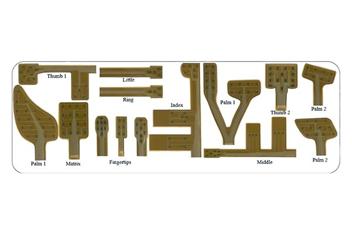
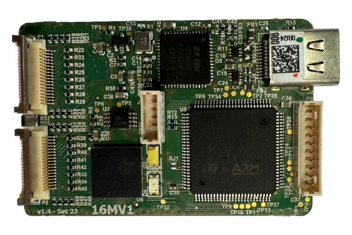
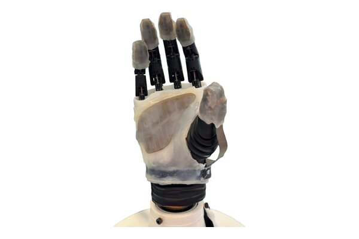
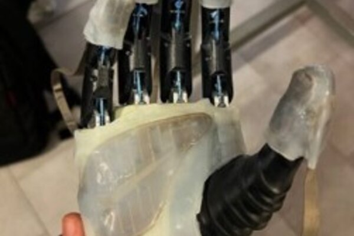

<picture>
  <source media="(prefers-color-scheme: dark)" srcset="img/banner-dark.png">
  
</picture>

**COSMIC Lab** (Connected Objects, Sensing Materials and Integrated Circuits) is a research group at DITEN, the Department of Electrical, Electronic, Telecommunication Engineering and Naval Architecture of the University of Genoa.

We build artificial tactile sensing systems: flexible piezoelectric skins, the electronics that read them, and the algorithms that turn their signals into touch, for prosthetic hands, robots and wearables.

  <a href="#research"><b>Research</b></a> ·
  <a href="#open-datasets"><b>Open datasets</b></a> ·
  <a href="#code"><b>Code</b></a> ·
  <a href="#where-our-sensors-are-used"><b>Where our sensors are used</b></a> ·
  <a href="#collaborations"><b>Collaborations</b></a>

## Research

<table>
  <tr>
    <td width="50%" valign="top">
      
      <h3>Piezoelectric e-skin</h3>
      
Screen-printed P(VDF-TrFE) sensors on flexible substrates, shaped for fingertips, fingers and palm and embedded in soft silicone. They respond to time-varying contact forces from below 1 Hz to 1 kHz.

    </td>
    <td width="50%" valign="top">
      
      <h3>Embedded interface electronics</h3>
      
Compact boards that digitise the sensor charge and process it on an STM32 microcontroller: 64 channels at 2 kSa/s, 16 bit, streamed over USB-C.

       <a href="https://github.com/cosmiclab-unige/interface-boards-otbio">interface-boards-otbio</a>
    </td>
  </tr>
  <tr>
    <td width="50%" valign="top">
      
      <h3>Tactile perception and edge ML</h3>
      
Force reconstruction, texture and hardness recognition, object recognition and slip detection, with neural, spiking and neuromorphic models sized for microcontrollers and FPGAs.

       <a href="https://github.com/cosmiclab-unige/Force_recontruction_algorithm">Force reconstruction</a> · <a href="https://github.com/cosmiclab-unige/sie2024-FPGA-CRNN">FPGA CRNN</a> · <a href="https://github.com/cosmiclab-unige/hardware-aware-nas-imu">HW-aware NAS</a>
    </td>
    <td width="50%" valign="top">
      
      <h3>Sensory feedback and prosthetics</h3>
      
Tactile sensing on prosthetic hands, with electrotactile feedback to the user, teleoperation and rehabilitation.

       <a href="https://github.com/cosmiclab-unige/Tactile-Sensing-Experimental-Videos">Experiment videos</a>
    </td>
  </tr>
</table>

## Open datasets

Raw tactile signals from our sensing systems, released with the papers that use them.

| Dataset | What is inside | Paper |
|---|---|---|
| [Contact and slip detection](https://github.com/cosmiclab-unige/Piezoelectric-Tactile-Contact-and-Slip-Detection-Dataset) | 8 P(VDF-TrFE) channels on a silicone fingertip, 2 kHz. 300 trials of contact onset, slip onset and release, plus 150 trials on three textures. | *Contact Events and Slip Onset Detection Based on a Piezoelectric Sensing System and Embedded Machine Learning* |
| [Hardness and texture on Hannes](https://github.com/cosmiclab-unige/Hardness-and-Texture-Recognition-based-on-PVDF-Sensors-and-Embedded-Machine-Learning) | 8 PVDF channels in the thumb of the Hannes prosthetic hand, 2 kHz. 200 grasps of four objects (press, hold, release). | [IEEE Xplore](https://ieeexplore.ieee.org/abstract/document/11043586) |
| [Neuromorphic texture classification](https://github.com/cosmiclab-unige/Neuromorphic-Tactile-Sensing-System-for-Textural-Features-Classification) | 8 channels on a biomimetic fingertip, 2 kHz. 8 gratings × 6 sliding conditions × 100 trials. | [10.1109/JSEN.2024.3382369](https://doi.org/10.1109/JSEN.2024.3382369) |
| [Texture domain adaptation](https://github.com/cosmiclab-unige/Linear-Optimal-Transport-for-Domain-Adaptation-in-Neuromorphic-Tactile-Texture-Classification) | 8 channels on a finger cap worn by 3 participants exploring 12 natural textures, 2 kHz. | *Linear Optimal Transport for Domain Adaptation in Neuromorphic Tactile Texture Classification* |
| [Hardness on a Baxter gripper](https://github.com/cosmiclab-unige/Embedded-real-time-objects-hardness-classification-for-robotic-grippers) | Grasps of cubes and cylinders at five hardness levels, with training scripts for three ML models. | |
| [Tactile-Datasets](https://github.com/cosmiclab-unige/Tactile-Datasets) | Links to real-time tactile datasets: [D_T1000](https://doi.org/10.5281/zenodo.20835836), [D_Objects](https://doi.org/10.5281/zenodo.20843033). | |

## Code

| Repository | What |
|---|---|
| [Force_recontruction_algorithm](https://github.com/cosmiclab-unige/Force_recontruction_algorithm) | Force reconstruction from PVDF tactile signals (Python) |
| [hardware-aware-nas-imu](https://github.com/cosmiclab-unige/hardware-aware-nas-imu) | Evolutionary NAS for a 1D-CNN on IMU data, with Flash and RAM checks for an STM32 target |
| [sie2024-FPGA-CRNN](https://github.com/cosmiclab-unige/sie2024-FPGA-CRNN) | CRNN for tactile texture classification, synthesised for FPGA with hls4ml |
| [Neuromorphic_ROS](https://github.com/cosmiclab-unige/Neuromorphic_ROS) | ROS Noetic Docker environment for the neuromorphic tactile experiments |
| [3-Class-Pinch-Pins](https://github.com/cosmiclab-unige/3-Class-Pinch-Pins) | Pinch classification with a 1D-CNN on IMU data |
| [interface-boards-otbio](https://github.com/cosmiclab-unige/interface-boards-otbio) | Schematics, firmware and C++ host code for the interface boards |

## Where our sensors are used

<table>
  <tr>
    <td width="33%" align="center"> <b>Hannes</b> prosthetic hand</td>
    <td width="33%" align="center"> <b>AR10</b> robotic hand</td>
    <td width="33%" align="center"> <b>Finger cap</b> for human users</td>
  </tr>
</table>

We have also fitted the sensors to the Michelangelo prosthetic hand, the TIAGo robot gripper and a Baxter gripper.

## Collaborations

IIT Rehab Lab (Genoa) · University of Genoa · University of Bologna · INAIL (Bologna) · Aalborg University · Ospedale San Martino (Genoa) · JOANNEUM RESEARCH · OT Bioelettronica · Tecnalia

EU projects: INTELLIMAN, TACTILITY.

---

Questions about a dataset or a repository? Open an issue in that repository.
